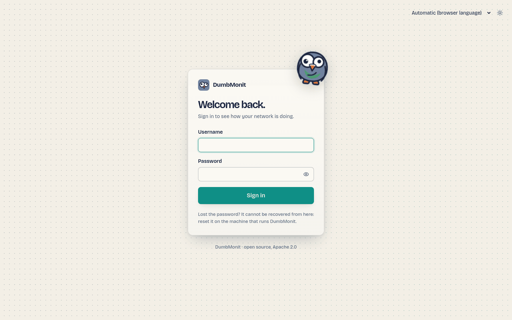

# Instalar com Docker {#install-with-docker}

O DumbMonit corre num único contentor: o servidor `dumbmonit` (recolha, API,
alertas, UI web) inicia o seu próprio VictoriaMetrics para armazenar as séries
temporais; o binário vem na imagem. A configuração e o estado vivem numa base de
dados SQLite integrada. Um volume, `/data`, contém a base de dados, o segredo da
instância e as séries temporais.

!!! note "Tags de imagem"
    `ghcr.io/laupernoe/dumbmonit:latest` é a última versão etiquetada (amd64;
    as imagens arm64 estão suspensas por agora); `:edge` segue o último commit em `dev`. Para correr a partir do código-fonte,
    `docker compose -f docker-compose.yml -f docker-compose.dev.yml up -d
    --build` compila a mesma imagem localmente (cerca de dez minutos da
    primeira vez; só é necessário o Docker).

## Pré-requisitos {#prerequisites}

- Docker Engine com o plugin Compose (`docker compose version` funciona).
- Uma máquina que consiga alcançar os monitores que quer monitorizar. Não precisa
  de ser alcançável por eles, exceto no caso dos [agentes](../devices/agent.md), que enviam
  as suas medições para o servidor por HTTP.
- Porta `8080` livre no anfitrião, ou outra porta à sua escolha ([veja abaixo](#advanced-options)).

## O ficheiro Compose {#the-compose-file}

Este é o `docker-compose.yml` completo (não é preciso nenhum ficheiro `.env`);
guarde-o numa pasta própria:

```yaml
services:
  dumbmonit:
    image: ghcr.io/laupernoe/dumbmonit:latest
    ports:
      - "8080:8080"
    volumes:
      - dumbmonit-data:/data
      # Or a host directory; on a SELinux host (Fedora, RHEL) add `:Z`:
      # - ./dumbmonit:/data:Z
    # environment:
    #   PUID: "1000"   # owner of the files in /data (default 65532)
    #   PGID: "1000"
    restart: unless-stopped
    stop_grace_period: 30s
    read_only: true
    tmpfs: [/tmp]
    # Starts as root only to give /data to user 65532 (or PUID/PGID), then
    # drops root for good: a host directory works as it is. Remove `user` and
    # `cap_add` to run as 65532 from the start (the files must belong to it).
    user: "0:0"
    cap_drop: [ALL]
    cap_add: [CHOWN, DAC_READ_SEARCH, SETUID, SETGID]
    security_opt: ["no-new-privileges:true"]
    sysctls:
      net.ipv4.ping_group_range: "0 2147483647"

volumes:
  dumbmonit-data:
    name: dumbmonit-data
```

Depois, arranque-o:

```bash
docker compose up -d
```

A imagem publicada é obtida; o sistema de ficheiros só de leitura, as
capabilities, `PUID`/`PGID` e o sysctl `ping_group_range` são explicados em
[Permissões e diretoria de dados](#permissions) e
[Ping ICMP sem capability](#icmp-ping-without-a-capability). As opções
(porta, segredo, retenção, VictoriaMetrics externo, capturas de ecrã) são
[variáveis de ambiente que você mesmo acrescenta](#advanced-options).

!!! tip "Compilar a imagem você mesmo"
    A partir de um clone do repositório, `docker compose -f docker-compose.yml -f
    docker-compose.dev.yml up -d --build` compila a mesma imagem localmente (cerca
    de dez minutos a frio; não é necessária nenhuma toolchain Rust ou Node no
    anfitrião). Use-o para correr a partir do código-fonte ou de um ramo.

## VictoriaMetrics integrado {#embedded-victoriametrics}

A imagem contém o binário do VictoriaMetrics (`/victoria-metrics-prod`, de
`victoriametrics/victoria-metrics:v1.152.0`). Quando `DUMBMONIT_VM_URL` não está
definida, o servidor inicia-o como processo filho a escutar em `127.0.0.1:8428`,
guarda as suas séries em `/data/vm`, reencaminha as suas linhas de registo para o seu próprio registo,
reinicia-o com espera progressiva se morrer e para-o no encerramento. Nada é
publicado: a porta fica dentro do contentor.

Vale a pena conhecer duas variáveis: `DUMBMONIT_VM_RETENTION` (`12` meses por
omissão; `30d` ou `2y` também funcionam) e `DUMBMONIT_VM_MEMORY` (`256MB`, o
orçamento das suas caches; aumente-o para centenas de máquinas). O resto está na
[referência de configuração](../reference/configuration.md#embedded-victoriametrics).

Para usar um VictoriaMetrics que já tenha, defina `DUMBMONIT_VM_URL` com o seu
endereço (`http://host:8428`): o integrado deixa então de ser iniciado e
`/data/vm` fica vazio.

## Primeiro arranque {#first-start}

Abra `http://<o-seu-anfitrião>:8080`. Uma instância nova mostra o ecrã `/setup`,
onde cria a primeira conta de administrador (palavra-passe de pelo menos 12
caracteres).

O ecrã pede primeiro o **código de configuração**. Enquanto não existir nenhum administrador,
o servidor imprime um código de utilização única nos registos ao arrancar:

```sh
docker compose logs dumbmonit | grep -A1 "setup code"
```

```
  First-run setup code: K7XQ4-M9PRT
```

Prova que quem cria a conta de administrador controla o servidor, para que outra
pessoa na rede não possa reclamar primeiro uma instância nova. O código existe apenas
em memória, muda a cada reinício até existir um administrador, e as tentativas
erradas têm limitação de taxa. Numa implementação automatizada, defina
`DUMBMONIT_SETUP_CODE` para o escolher você mesmo.

{ loading=lazy }

Depois adicione o seu primeiro monitor: veja [Adicionar o primeiro monitor](first-device.md).

## Variáveis de ambiente {#environment-variables}

Tudo passa por variáveis de ambiente; nenhuma é obrigatória. Acrescente as de que
precisar em `environment:` do serviço, como mostrado em
[Opções avançadas](#advanced-options).

| Variável | Valor por omissão | Função |
|---|---|---|
| `DUMBMONIT_BIND` | `0.0.0.0:8080` | Endereço de escuta dentro do contentor. |
| `PUID` / `PGID` | `65532` | Com `user: "0:0"`: utilizador e grupo com que o servidor corre, e dono dos ficheiros em `/data` ([detalhes](#permissions)). `DUMBMONIT_PUID` / `DUMBMONIT_PGID` também funcionam. |
| `DUMBMONIT_DATA_DIR` | `/data` | Base de dados SQLite (`dumbmonit.db`), segredo da instância (`secret.key`) e dados do VictoriaMetrics integrado (`vm/`). |
| `DUMBMONIT_VM_URL` | *(não definida)* | URL de um VictoriaMetrics externo. Quando definida, o integrado não é iniciado. |
| `DUMBMONIT_VM_RETENTION` | `12` | Retenção do VictoriaMetrics integrado: meses, ou `30d`, `2y`. |
| `DUMBMONIT_VM_MEMORY` | `256MB` | Orçamento de memória das caches do VictoriaMetrics integrado. |
| `DUMBMONIT_VM_LISTEN` | `127.0.0.1:8428` | Endereço de escuta do VictoriaMetrics integrado, dentro do contentor. |
| `DUMBMONIT_SECRET` | *(gerado)* | Segredo da instância que cifra as credenciais dos monitores e os tokens. |
| `DUMBMONIT_MAX_CONCURRENT_PROBES` | `64` | Sondagens simultâneas, todos os coletores combinados. |
| `DUMBMONIT_PROBE_TIMEOUT_SECS` | `10` | Duração máxima de uma sondagem. |
| `DUMBMONIT_FLUSH_INTERVAL_SECS` | `5` | Período de escrita para o VictoriaMetrics. |
| `DUMBMONIT_LOG` | `info` | Filtro de registo (sintaxe `tracing`, p. ex. `debug`, `dumbmonit=trace`). |
| `DUMBMONIT_AGENT_DIR` | `/agents` | Binários dos agentes servidos em `/download/…`. |
| `DUMBMONIT_RESET_PASSWORD` | *(vazia)* | Defina como `1` para apagar a palavra-passe e todas as sessões no arranque. |
| `DUMBMONIT_SETUP_CODE` | *(gerado)* | Código de configuração pedido por `/setup` enquanto não existir administrador. Se não definido, é impresso um aleatório nos registos em cada arranque. |
| `DUMBMONIT_COOKIE_SECURE` | *(desativado)* | Defina como `1` atrás de um proxy inverso TLS para marcar o cookie de sessão como `Secure`. |
| `DUMBMONIT_ALERT_INTERVAL_SECS` | `30` | Período de avaliação dos alertas (nunca inferior a 10). |
| `DUMBMONIT_ALERT_HISTORY_DAYS` | 90 dias | Retenção do histórico de alertas. Veja a [referência de configuração](../reference/configuration.md) para uma ressalva sobre a sua unidade. |
| `DUMBMONIT_BACKUP_ENABLED` | ativado | Cópias de segurança locais agendadas da base de dados em `/data/backups/`. `DUMBMONIT_BACKUP_DIR`, `_INTERVAL_HOURS` (24) e `_KEEP` (7) ajustam-nas; veja [Cópia de segurança e restauro](backup.md). |

A lista completa, com detalhes, está na [referência de configuração](../reference/configuration.md).
Os nomes `EZYMONIT_*` anteriores à mudança de nome continuam a ser lidos como alternativa; veja
[Atualização](#upgrading).

## Copiar a chave secreta {#back-up-the-secret-key}

As comunidades SNMP, as palavras-passe e os tokens de API são cifrados com AES-256-GCM usando uma
chave derivada do segredo da instância. No primeiro arranque, o DumbMonit gera este
segredo em `/data/secret.key` (dentro do volume `dumbmonit-data`).

!!! danger "Copie `secret.key` em conjunto com a base de dados"
    Sem ele, as credenciais dos monitores são irrecuperáveis: uma base de dados restaurada
    sozinha dá uma instância que não consegue comunicar com nada. O servidor deteta uma
    chave em falta ou alterada no arranque e recusa continuar com uma mensagem
    explícita, em vez de falhar silenciosamente em cada sondagem. As cópias de segurança agendadas
    copiam-no por si — veja [Cópia de segurança e restauro](backup.md).

Se preferir ser dono do segredo, defina `DUMBMONIT_SECRET` no ficheiro Compose
([exemplo](#advanced-options)) (32 caracteres aleatórios ou mais). Guarde-o no seu gestor de palavras-passe.

## Atualização {#upgrading}

```bash
docker compose pull
docker compose up -d
```

As migrações da base de dados correm no arranque. Os dados do VictoriaMetrics não são tocados.

!!! tip "Faça primeiro uma cópia de segurança"
    **Definições → Cópia de segurança → Copiar agora** escreve em poucos segundos uma cópia consistente da base de dados
    e de `secret.key` em `/data/backups/`, e é a partir dela que
    restaura se a atualização correr mal. Veja
    [Cópia de segurança e restauro](backup.md).

### Bind mounts {#from-cap-drop-all}

Um `docker-compose.yml` existente continua a funcionar tal como está: a imagem
continua a correr com o utilizador 65532. O ficheiro novo acrescenta `user: "0:0"`
e uma linha `cap_add` para que uma diretoria do anfitrião funcione sem preparação
([Permissões](#permissions)); copie estas duas linhas se quiser passar a um bind
mount.

### A partir do EzyMonit e da configuração de dois contentores {#from-ezymonit-and-from-the-two-container-setup}

O DumbMonit chamava-se EzyMonit até setembro de 2026, e corria em dois contentores,
o servidor e um serviço `victoriametrics` separado. A atualização exige mover uma vez os dados
do projeto antigo para o novo volume. O projeto antigo chamava-se
`ezymonit` (os seus volumes `ezymonit_ezymonit-data` e `ezymonit_vm-data`;
`docker volume ls` confirma). A partir da pasta antiga:

```bash
docker compose down
```

Depois, com o novo `docker-compose.yml`:

```bash
docker volume create dumbmonit-data
docker run --rm -v ezymonit_ezymonit-data:/from -v dumbmonit-data:/to alpine cp -a /from/. /to/
docker run --rm -v ezymonit_vm-data:/from -v dumbmonit-data:/to alpine sh -c 'mkdir -p /to/vm && cp -a /from/. /to/vm/'
docker compose up -d
```

A antiga pasta de dados do VictoriaMetrics tem a estrutura que o integrado usa:
nada a converter. A alternativa é manter o VictoriaMetrics externo e
apontar `DUMBMONIT_VM_URL` para ele.

O que o servidor trata sozinho no primeiro arranque:

- As variáveis `EZYMONIT_*` continuam a ser lidas como alternativa, com um aviso de arranque
  por variável (`EZYMONIT_X is deprecated, use DUMBMONIT_X`).
- `/data/ezymonit.db` é renomeado para `dumbmonit.db`.
- Os tokens de agente `ezym_…` continuam a funcionar; os novos são `dmon_…`. Os agentes continuam
  a enviar; volte a executar o comando de instalação em cada máquina quando for conveniente, ele
  [migra o serviço antigo no local](../devices/agent.md#upgrade).
- O cookie de sessão mudou de nome: todos iniciam sessão de novo uma vez. A preferência
  de tema do navegador é preservada.

O que não trata: o prefixo das métricas mudou de `ezymonit_` para
`dumbmonit_` sem compatibilidade. As séries antigas ficam no VictoriaMetrics com
o nome antigo e expiram com a retenção; os gráficos e as regras integradas recomeçam
na atualização. As regras de alerta personalizadas que referem métricas `ezymonit_…` têm de ser
editadas.

## Cópia de segurança e restauro {#backup-and-restore}

Um volume nomeado, `dumbmonit-data`, contém tudo:

| Caminho | Conteúdo |
|---|---|
| `dumbmonit.db` | Monitores, regras, canais, estado dos alertas, sessões. |
| `secret.key` | O segredo da instância. |
| `backups/` | As cópias de segurança locais agendadas: uma cópia da base de dados e do segredo, diária por omissão, sete mantidas. |
| `vm/` | Séries temporais do VictoriaMetrics (12 meses de retenção por omissão). |

O DumbMonit faz cópias da sua própria base de dados de forma agendada, e exporta toda a
configuração — monitores, credenciais, regras, canais — num único ficheiro
cifrado com uma frase-passe à sua escolha, que se restaura numa instância nova.
Ambos estão em **[Cópia de segurança e restauro](backup.md)**, juntamente com o que fazer antes de
uma atualização e a única regra sobre `secret.key` que vale a pena ler duas vezes.

Para arquivar o próprio volume, gráficos incluídos, pare a stack e crie um tar:

```bash
docker compose stop
docker run --rm -v dumbmonit-data:/data -v "$PWD:/backup" alpine \
  tar czf /backup/dumbmonit-data.tgz -C /data .
docker compose start
```

Para restaurar, crie o volume, extraia o arquivo para dentro dele da mesma forma e depois
`docker compose up -d`.

Se o espaço importar, `--exclude=./vm` mantém o arquivo pequeno: a base de dados e
o segredo são a configuração, `vm/` são apenas os gráficos.

## Opções avançadas {#advanced-options}

O ficheiro Compose acima não tem variáveis, de propósito. Para mudar uma
definição, acrescente um bloco `environment:` (ou uma linha nele) em
`dumbmonit:` no seu `docker-compose.yml` e volte a executar
`docker compose up -d`. O contentor é recriado; o volume de dados mantém-se.

**Outra porta.** Mude o lado esquerdo do mapeamento; o contentor continua a
escutar na 8080:

```yaml
    ports:
      - "8099:8080"
```

**O seu próprio segredo**, em vez do gerado em `/data/secret.key`. Cifra as
credenciais dos monitores: perdê-lo significa voltar a introduzir cada uma
delas.

```yaml
    environment:
      DUMBMONIT_SECRET: replace-me-with-32-random-characters
```

**Retenção e memória** do VictoriaMetrics integrado (meses, ou `30d` / `2y`;
um homelab com algumas dezenas de monitores cabe em 256 MB):

```yaml
    environment:
      DUMBMONIT_VM_RETENTION: "24"
      DUMBMONIT_VM_MEMORY: 512MB
```

**VictoriaMetrics externo**; o integrado deixa então de ser iniciado:

```yaml
    environment:
      DUMBMONIT_VM_URL: http://victoriametrics:8428
```

**Palavra-passe perdida.** Acrescente a linha abaixo, execute
`docker compose up -d`, crie de novo o primeiro administrador na UI
(monitores, regras e canais mantêm-se), depois remova a linha e execute
`docker compose up -d` mais uma vez:

```yaml
    environment:
      DUMBMONIT_RESET_PASSWORD: "1"
```

**Capturas de ecrã das alterações de sites**: um Chromium sem interface junto ao servidor; veja abaixo [Capturas de ecrã das alterações de sites](#website-screenshots).

Mais variáveis: [referência de configuração](../reference/configuration.md).

## Capturas de ecrã das alterações de sites {#website-screenshots}

O [monitor de alterações de sites](../devices/webchange.md) compara sempre o texto visível das páginas. Guardar uma captura de ecrã de cada nova versão requer um navegador, e a imagem do DumbMonit não inclui nenhum: um Chromium sem interface corre como segundo serviço, e `DUMBMONIT_BROWSER_URL` indica ao servidor onde o encontrar.

Adicione estas linhas ao seu `docker-compose.yml` e execute depois `docker compose up -d`:

```yaml
services:
  dumbmonit:
    environment:
      DUMBMONIT_BROWSER_URL: http://browser:9222
  browser:
    image: chromedp/headless-shell:stable
    shm_size: 256m
    restart: unless-stopped
```

- `browser` é o nome do serviço; na rede do Compose, `http://browser:9222` leva até ele. Nada publica a sua porta: só o DumbMonit lhe fala.
- `shm_size: 256m`: o Chromium renderiza em `/dev/shm`, e os 64 MB predefinidos do Docker são pouco para uma página longa.
- Serve qualquer Chromium iniciado com `--remote-debugging-port`; aqui usa-se a imagem `chromedp/headless-shell`.

Sem navegador, tudo o resto funciona como habitualmente (comparação de texto, alertas, cópias antes/depois); os instantâneos apenas não têm imagem. Enquanto o servidor não alcançar um navegador, o formulário de um monitor de alterações de sites mostra um aviso com estas linhas.
Se o aviso persistir após o reinício, verifique `docker compose logs browser`, se o nome do anfitrião em `DUMBMONIT_BROWSER_URL` é o nome do serviço e se os dois serviços estão no mesmo projeto Compose.

## Proxy inverso {#reverse-proxy}

A UI e a API são servidas numa só porta em HTTP simples. Não se usa WebSocket:
a interface consulta a API periodicamente, pelo que qualquer proxy inverso funciona sem configuração
especial.

=== "Caddy"

    ```
    monit.example.com {
        reverse_proxy 127.0.0.1:8080
    }
    ```

=== "nginx"

    ```nginx
    server {
        listen 443 ssl;
        server_name monit.example.com;
        # ssl_certificate / ssl_certificate_key …

        location / {
            proxy_pass http://127.0.0.1:8080;
            proxy_set_header Host $host;
            proxy_set_header X-Forwarded-Proto $scheme;
            # Os agentes enviam lotes de recuperação após uma interrupção:
            client_max_body_size 16m;
        }
    }
    ```

Quando o proxy termina o TLS, defina `DUMBMONIT_COOKIE_SECURE: "1"` para que o cookie de
sessão só seja enviado por HTTPS. Não o defina numa implementação em HTTP simples: o
navegador nunca devolveria o cookie e o início de sessão seria impossível.

!!! note "Agentes atrás de um proxy"
    O comando de instalação mostrado ao criar um token de agente usa o URL que o seu
    navegador usou para chegar à UI. Se for o URL do proxy, os agentes usá-lo-ão
    também: certifique-se de que `/install.sh`, `/install.ps1`, `/download/…` e `/api/ingest`
    passam pelo proxy.

## Permissões e diretoria de dados {#permissions}

O servidor nunca corre como root. Por predefinição, a imagem corre com o
utilizador `65532:65532`, a quem um volume com nome criado pelo Docker já pertence.

Um bind mount (`./dumbmonit:/data`), pelo contrário, mantém o dono da diretoria
do anfitrião, muitas vezes root quando foi o Docker a criá-la. É por isso que o
ficheiro Compose acima arranca o contentor como root (`user: "0:0"`). O servidor
só fica root por um instante: antes de abrir a base de dados, arrancar o
VictoriaMetrics ou escutar na rede, entrega `/data` a `65532:65532` (só as
entradas que pertencem a outra pessoa, sem seguir ligações simbólicas), abandona o
root de vez e verifica que não o consegue recuperar. As quatro capabilities de
`cap_add` servem só este passo; nenhuma fica depois. `no-new-privileges` e o
sistema de ficheiros raiz só de leitura mantêm-se: `/data` e `/tmp` são os únicos
caminhos graváveis.

**Escolher o dono: `PUID` e `PGID`.** Com `user: "0:0"`, indique o uid e o gid com
que o servidor corre; os ficheiros são-lhes entregues no arranque:

```yaml
    environment:
      PUID: "1000"
      PGID: "1000"
```

`DUMBMONIT_PUID` / `DUMBMONIT_PGID` também funcionam e têm prioridade. O `0` é
recusado. No Unraid, `PUID=99` e `PGID=100` correspondem ao dono habitual de
`appdata`. Sem `user: "0:0"`, `PUID`/`PGID` são ignorados.

**Sem `user: "0:0"`** (um simples `docker run -v ./data:/data`, ou `--user
1000:1000`), nenhum dono muda e `/data` já tem de ser gravável. Se não for, o
servidor para e sugere primeiro `--user 0:0`, depois
`sudo chown -R 65532:65532 ./data` no anfitrião para um bind mount ou, para um
volume com nome:

```bash
docker run --rm -v dumbmonit-data:/data alpine chown -R 65532:65532 /data
```

### SELinux e Podman {#selinux-and-podman}

Num anfitrião onde o SELinux está em modo enforcing (Fedora, RHEL, CentOS
Stream, AlmaLinux…), um bind mount é recusado ao contentor, mesmo ao root,
enquanto não tiver uma etiqueta de contentor. Acrescente `:Z` ao volume, ou `:z`
se outros contentores partilham a pasta:

```yaml
    volumes:
      - ./dumbmonit:/data:Z
```

Sem isso, o servidor termina com `the host enforces SELinux and the volume has
no container label`. Os volumes nomeados são etiquetados pelo Docker e não
precisam de nada.

O Podman sem root funciona da mesma forma, com `--user 0:0`. O root no contentor é o seu próprio
utilizador no anfitrião, e os ficheiros de um bind mount vão para o uid 65532 do
contentor, que o anfitrião mostra como um dos seus sub-uids (`165531` com o
`/etc/subuid` habitual). Leia-os com `podman unshare ls -l ./dumbmonit`. Para os
manter antes sob o seu próprio uid, execute o contentor como você; nenhum dono
muda então:

```bash
podman run --userns keep-id --user "$(id -u):$(id -g)" -v ./dumbmonit:/data:Z …
```

## Ping ICMP sem capability {#icmp-ping-without-a-capability}

O [monitor de ping](../devices/services.md#ping) envia ecos ICMP. Em vez de
um socket raw — que precisa de `NET_RAW`, e uma capability concedida a um utilizador de contentor
sem privilégios não é utilizável de qualquer modo — usa um socket ICMP echo, que o Linux
permite aos grupos listados em `net.ipv4.ping_group_range`. O ficheiro Compose
define esse sysctl dentro do espaço de nomes de rede do próprio contentor:

```yaml
services:
  dumbmonit:
    sysctls:
      net.ipv4.ping_group_range: "0 2147483647"
```

Nada muda no anfitrião. O Docker 20.10 e posteriores definem este intervalo em todos os
contentores por si; as linhas explícitas garantem-no em motores mais antigos
e no Podman. Sem ele, a verificação reporta um erro de configuração (mostrado no
monitor, não notificado), nunca um falso «anfitrião em baixo». Com `docker run`, passe
`--sysctl net.ipv4.ping_group_range="0 2147483647"`. Enquanto o servidor não conseguir abrir um socket ICMP, o formulário de um monitor de ping mostra um aviso com estas linhas.

## Testar sem hardware {#testing-without-hardware}

Adicione um [monitor de demonstração](../devices/demo.md): produz medições falsas sem
nada para preparar, pelo que os gráficos, as regras e as notificações podem ser experimentados
de imediato. Para dados SNMP reais, a máquina que corre o Docker muitas vezes chega — instale
o `snmpd` nela (`apt install snmpd`, permita a comunidade `public` na bridge do Docker
em `/etc/snmp/snmpd.conf`) e adicione um dispositivo SNMP com o endereço do anfitrião
nessa bridge (`172.17.0.1` por omissão): o perfil é detetado
automaticamente e aparecem interfaces, memória e processos.

Os programadores podem adicionar a sobreposição `docker-compose.dev.yml` para publicar o VictoriaMetrics
integrado no `:8428` do anfitrião para consultas MetricsQL diretas:

```bash
docker compose -f docker-compose.yml -f docker-compose.dev.yml up -d
```
