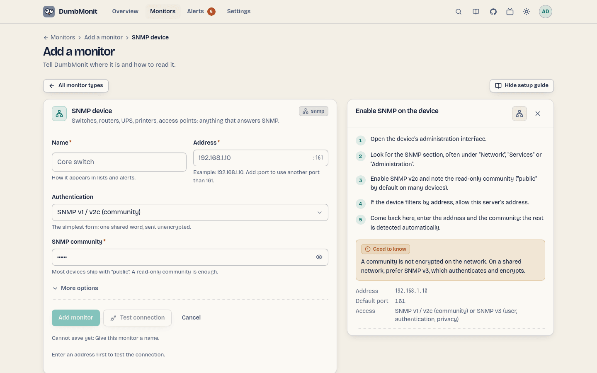

# Ihren ersten Monitor hinzufügen

Etwas hinzuzufügen funktioniert immer gleich: eine Art aus der Liste
wählen, ein Hinweis rechts erklärt, was am Gerät vorzubereiten ist, und
das Formular zeigt nur die für diese Art relevanten Felder.

## Die drei ersten Schritte {#the-three-first-steps}

Auf einer brandneuen Instanz zeigt die Übersicht kein leeres Bulletin:
Sie zeigt eine kurze Anleitung — **Ihren ersten Monitor hinzufügen**, **eine
Art, benachrichtigt zu werden, verbinden**, **prüfen, dass eine
Nachricht ankommt**. Jeder Schritt ist ein Klick, und jeder wird für
sich grün. Der dritte zählt nur eine Nachricht, die einen Kanal
tatsächlich verlassen hat, daher zählt das Erstellen eines Kanals, ohne
ihn je zu testen, nicht.

Die Anleitung wird auf der Instanz gehalten, nicht im Browser: Einen
Schritt zu überspringen, oder die gesamte Anleitung, überspringt ihn in
jedem Browser und für jeden Benutzer. Sie verschwindet endgültig, sobald
die drei Schritte erledigt sind, und erscheint nie auf einer Instanz,
die schon Monitore und einen Kanal hatte — ein Upgrade gibt einem
etablierten Homelab kein Tutorial.

## Einen SNMP-Monitor hinzufügen {#add-an-snmp-device}

SNMP ist die universellste Art: fast jede Netzwerk-Hardware spricht es.
Switches, Router, NAS, USV und Drucker sind die üblichen Verdächtigen.

1. Aktivieren Sie am Gerät SNMP v2c und merken Sie sich die
   nur-lesende Community (standardmäßig "public" bei vielen Geräten).
   Filtert das Gerät nach Adresse, erlauben Sie die Adresse des
   DumbMonit-Servers.
2. Öffnen Sie in DumbMonit **Monitors** und klicken Sie auf **Add a
   monitor** (oder drücken Sie ++ctrl+k++ und tippen Sie "add").
3. Wählen Sie **SNMP device**. Der Picker klappt sich zu einer Zeile
   zusammen, und das Formular zeigt die Felder für SNMP.
4. Geben Sie einen **Namen**, die **Adresse** (IP oder Hostname) und
   die **Community** ein. Für SNMP v3 schalten Sie das Credential auf
   *SNMP v3* und füllen Benutzername und die Authentifizierungs- und
   Privacy-Passphrasen aus.
5. Klicken Sie auf **Add monitor**.

{ loading=lazy }

Das Erfassungsprofil wird automatisch im Hintergrund aus der
`sysObjectID` des Geräts erkannt, sodass das Formular nie auf ein
nicht erreichbares Gerät wartet. Schnittstellen, und auf Servern und
NAS die CPU, Speicher und Storage, erscheinen innerhalb einer Minute.

!!! warning "Communities reisen im Klartext"
    Eine SNMP-v1/v2c-Community ist im Netzwerk nicht verschlüsselt. In
    einem gemeinsam genutzten Netzwerk bevorzugen Sie SNMP v3, das
    authentifiziert und verschlüsselt.

## Ein Netzwerk scannen

Statt Monitore einzeln einzugeben, scannen Sie einen Bereich:

1. Öffnen Sie bei **Add a monitor** das Panel **Scan my network**.
2. Geben Sie ein Netzwerk in CIDR-Notation ein, zum Beispiel
   `192.168.1.0/24` (bis zu 4096 Adressen pro Scan), und die auf jeder
   Adresse zu versuchende Community (standardmäßig "public").
3. Jede antwortende Adresse wird mit ihrem `sysName`, der Beschreibung
   und dem anzuwendenden Profil gelistet. Bereits in DumbMonit
   vorhandene Monitore sind als *Already added* markiert, und alles Neue
   ist für Sie angekreuzt.
4. Entfernen Sie das Häkchen bei dem, was Sie nicht wollen, klicken Sie
   dann auf **Add *n* monitors**. Sie werden einzeln erstellt, jede
   Zeile zeigt ihr eigenes Ergebnis, sodass ein Fehlschlag nie den Rest
   stoppt.

## Einen Proxmox-VE-Server hinzufügen

Derselbe Ablauf, mit einem Credential in zwei Feldern statt einem:

1. Erstellen Sie in Proxmox einen für die Überwachung reservierten
   Benutzer, eine nur-lesende Rolle und ein API-Token — die vier
   `pveum`-Befehle stehen im Hinweis neben dem Formular, jeweils mit
   einem Kopier-Button, und auf der [Proxmox-VE-Seite](../devices/proxmox.md).
   Nutzen Sie nie das Konto wiederverwendet, mit dem Sie sich
   einloggen.
2. In DumbMonit, **Add a monitor** → **Proxmox VE**.
3. Geben Sie einen **Namen** und die **Adresse** eines beliebigen
   Knotens ein (standardmäßig Port 8006).
4. Kopieren Sie die **full-tokenid** des Tokens
   (`dumbmonit@pve!monitor`) in **Token ID** und ihren **Wert** (die
   UUID) in **Secret**. Haben Sie versehentlich den ganzen String
   `user@pve!name=secret` in Token ID eingefügt? Das Formular teilt
   ihn und sagt es.
5. Proxmox liefert ein selbstsigniertes Zertifikat: Kreuzen Sie
   **Accept an unverifiable certificate** unter *More options* an,
   falls sich die erste Abfrage darüber beschwert.
6. Klicken Sie auf **Add monitor**.

[Proxmox Backup Server](../devices/pbs.md) funktioniert genauso mit
`proxmox-backup-manager`; ein [Synology-NAS](../devices/synology.md)
nimmt ein dediziertes DSM-Konto (Benutzername und Passwort); ein
[Server mit dem Agent](../devices/agent.md) braucht überhaupt kein
Credential, nur das Enrollment-Token, das nach dem Speichern des
Monitors einmal angezeigt wird.

## Der Einrichtungshinweis

Jede Art trägt ihren eigenen, vom Server geschriebenen Hinweis, neben
dem Formular angezeigt: nummerierte Schritte am Gerät (einen
nur-lesenden Benutzer erstellen, ein API-Token erstellen, die Adresse
erlauben…), mit dem genauen Menüpfad im Produkt und einem
Kopier-Button bei jedem Befehl oder Wert, dann ein häufiger Fallstrick
und ein Link zur Dokumentation des Herstellers, falls vorhanden. Die
Seiten je Art in dieser Dokumentation tragen dieselben Schritte
wortgetreu — ein Test im Server hält sie identisch:
[SNMP](../devices/snmp.md), [Proxmox VE](../devices/proxmox.md),
[Proxmox Backup Server](../devices/pbs.md),
[Synology DSM](../devices/synology.md), [Agent](../devices/agent.md),
[Services](../devices/services.md).

Das Prinzip hinter jedem Hinweis: ein dediziertes, nur-lesendes Konto,
nie das, mit dem Sie sich einloggen. Ein durchgesickertes
Monitoring-Secret darf nichts ändern können.

## Gemeinsame Felder

Welche Art auch immer, das Formular hat:

| Feld | Bedeutung |
|---|---|
| Name | Wie der Monitor in Listen und Alarmen erscheint. |
| Address | IP, Hostname, `host:port` oder URL je nach Art; der Platzhalter zeigt die erwartete Form. |
| Credential | Die von der Art akzeptierten Familien, jede mit eigenen Feldern: Community, SNMP-v3-Benutzer und Passphrasen, Proxmox-Token (Token ID + Secret), Benutzername und Passwort. Secrets haben ein Zeigen/Verbergen-Auge, und eingefügte Werte werden von Leerzeichen, Anführungszeichen und Zeilenumbrüchen bereinigt. Verschlüsselt gespeichert, nie von der API zurückgegeben: Beim Bearbeiten behalten leere Felder das Gespeicherte. |
| Check interval | Wie oft DumbMonit den Monitor liest. Standard 60 s, Minimum 10 s. |
| Parent monitor | Geht der übergeordnete Monitor down, werden Alarme dieses Monitors unterdrückt statt gesendet. Siehe [Abhängigkeitsunterdrückung](../alerting/index.md#dependency-suppression). |
| Enabled | Ein pausierter Monitor wird nicht geprüft und löst keine Alarme aus. |
| Tags | Freie Schlüssel/Wert-Labels, auf jeder Zeitreihe als `tag_<key>` kopiert. Artspezifische Optionen liegen hier auch, unter **More options**. |

## Was als Nächstes passiert

- Der Monitor erscheint auf der **Monitors**-Seite als Rack-Frontblende:
  Status-LED, Name, Art, Adresse, zuletzt gesehen, und eine Sparkline.
- Messwerte werden alle 5 Sekunden in VictoriaMetrics geschrieben
  (`DUMBMONIT_FLUSH_INTERVAL_SECS`), daher erscheint das erste
  Diagramm nach der ersten Abfrage plus ein paar Sekunden. **Probe
  now** auf der Monitorseite erzwingt eine Abfrage und meldet, wie
  viele Samples und Zeitreihen sie erzeugt hat: Es ist das wichtigste
  Diagnosewerkzeug.
- Die [eingebauten Alarmregeln](../alerting/rules.md) gelten sofort:
  Monitor nicht erreichbar, CPU gesättigt, Platte fast voll, und so
  weiter. Nichts zu konfigurieren.
- Um benachrichtigt zu werden, fügen Sie einen
  [Benachrichtigungskanal](../notifications.md) unter
  **Settings → Notifications & reports** hinzu. Eingebaute Regeln benachrichtigen jeden
  aktivierten Kanal.

!!! tip "Keine Daten nach einer Minute?"
    Öffnen Sie die Monitorseite: Ein Konfigurationsfehler (falsche
    Community, abgelehntes Zertifikat, fehlende Fähigkeit) wird rot
    unter der Adresse mit dem Grund angezeigt. Siehe die
    [FAQ](../faq.md#no-data-after-adding-a-device).
