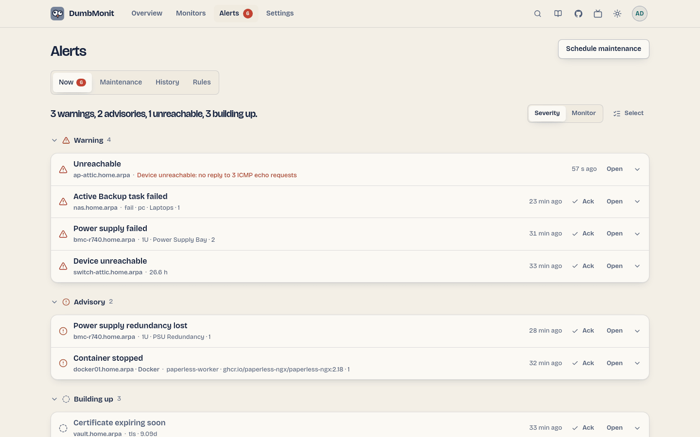

# A página de alertas {#alerts-page}

{ loading=lazy }

Tudo sobre alertas em uma página, por trás de quatro abas. A aba está na URL
(`/alerts#rules`), então uma visão pode ser compartilhada por link.
**Programar manutenção**, no canto superior direito, abre o formulário para
uma janela a partir de qualquer aba.

| Aba | O que contém |
|---|---|
| **Agora** | A lista ativa de problemas, uma linha cada. Veja [A lista Agora](#the-now-list). O selo na aba, e em Alertas na barra superior, é a contagem do que ainda precisa de você. |
| **Manutenção** | Janelas de manutenção, *Ativa agora* ou *Programada*, pontual, semanal ou mensal, cada uma com a próxima ocorrência (`#scheduled`). Veja [Janelas de manutenção](../alerting/maintenance.md). |
| **Histórico** | As últimas 200 transições, cada uma nomeando o monitor, a regra e o que aconteceu; as resolvidas podem ser limpas. |
| **Regras** | Toda regra com sua severidade, uma marca *Integrada* e, se algum monitor a ignora, *Ignorada em N monitores*; ativar, editar embutido, excluir as suas próprias, criar uma regra de limite. Veja [Regras](../alerting/rules.md). |

Os canais de notificação e a política de notificação ficam em
**Configurações → Notificações e relatórios** (veja
[Notificações](#notifications)).

O mesmo modelo de verdade alimenta o boletim da visão geral e esta página,
então os dois sempre concordam sobre o que precisa de você.

## A lista Agora {#the-now-list}

Uma linha por problema: ícone de estado, o que está errado, qual monitor, a
causa em uma linha, há quanto tempo, e **Reconhecer** e **Abrir** na própria
linha. As linhas são agrupadas por severidade (Alerta, Aviso, Info,
Acumulando, Suprimido pelo pai) ou, com o seletor **Severidade | Monitor**,
por monitor. Os grupos se dobram; *Suprimidos*, *Em soneca* e *Dispensados*
(reconhecidos) começam dobrados. Uma regra disparando em várias séries do
mesmo monitor é uma única linha ("… e mais 7").

Clique em uma linha para abrir os detalhes: cada série afetada, desde quando,
quem a reconheceu, por que está suprimida, com **Abrir monitor**, **Soneca** e
**Nunca para este monitor**.

Selecionar várias linhas é um modo. O botão **Selecionar** (operadores e
administradores) mostra uma caixa de seleção em cada linha e uma barra
flutuante na parte inferior com **Selecionar tudo**, **Reconhecer**,
**Desfazer reconhecimento**, **Ignorar para este monitor** e
**Concluir**. Escape sai do modo.

## Se livrando de um alerta {#getting-rid-of-an-alert}

Um alerta disparando não é binário — "resolver" ou "viver com o ruído para
sempre". Quatro ações, para quatro situações diferentes, abertas a
administradores e operadores (um visualizador vê o estado mas não pode
alterá-lo):

- **Reconhecer** ("estou cuidando disso") é para um alerta que você está
  trabalhando ativamente: "eu sei, pare de me lembrar por 4 h". O menu
  oferece 1 h, 4 h, 24 h ou *até resolver*, mais uma nota opcional para quem
  ler o cartão depois de você. O alerta continua disparando e sendo
  avaliado; apenas seus lembretes e escalonamentos pausam — incluindo o
  escalonamento para um segundo canal. Você ainda é avisado quando ele
  resolve, e o reconhecimento se limpa nesse momento — um alerta que volta
  depois notifica de novo. O cartão sai da lista principal para um grupo
  mais silencioso *Reconhecido*, lê *Reconhecido por alguém até um horário*,
  e oferece **Desfazer reconhecimento**.
- **Soneca** é para "não agora, verifique depois" sem afirmar que você está
  fazendo algo sobre isso: 1 h, 8 h, 1 dia ou *até resolver*. Diferente do
  Reconhecer, funciona abrindo uma janela de manutenção restrita aos rótulos
  exatos daquele alerta — uma regra irmã no mesmo monitor continua
  falando. O cartão se move para um grupo silencioso *Em soneca* mostrando
  o tempo restante, e oferece **Tirar da soneca**. Lembretes pausam da mesma
  forma que os de um reconhecimento.
- **Ignorar** ("não me alerte sobre isso de novo") é para uma regra que
  nunca fará sentido neste monitor: desativa essa regra apenas para esse
  monitor (uma substituição por monitor — veja
  [Substituições por monitor](../alerting/rules.md#per-device-overrides))
  e o alerta desaparece de vez, imediatamente, não apenas silenciado. É
  reversível: **Parar de ignorar** na página do monitor, ou da própria
  regra em Alertas → Regras, onde lê *Ignorada em N monitores*.
- **Limpar** é para o histórico, não para um alerta ativo: uma vez que uma
  transição resolveu, *Limpar* (ou *Limpar todas resolvidas*) a remove da
  visão padrão do Histórico. A linha permanece no banco de dados — nada é
  excluído — e *Mostrar limpas* a traz de volta.

Páginas de status públicas ignoram reconhecimentos e sonecas: um alerta
reconhecido ou em soneca ainda é um alerta para o mundo exterior. Uma regra
ignorada, por outro lado, nunca produziu um alerta em primeiro lugar.

## Notificações {#notifications}

Canais e a política vivem em **Configurações → Notificações e relatórios**
(`/settings/notifications`), seguidos dos [Relatórios](reports.md). Dois
painéis:

**Canais de notificação.** A lista de canais, cada um com seu tipo, *Ativado* ou
*Desativado*, quando enviou algo por último, e seu último erro se houver.
**Adicionar canal** abre um formulário construído a partir da descrição do
servidor para o tipo escolhido: configurações (visíveis) e segredos (apenas
escrita). **Enviar teste** envia uma mensagem de teste e mostra o resultado
embutido. As **Opções de entrega** de cada canal mantêm sua severidade
mínima, se ele ouve resoluções, um intervalo mínimo por alerta, e suas
**horas de silêncio** (semanais, em seu fuso horário: apenas alertas de
nível Warning passam, o resto espera por um resumo).

**Apenas alguns alertas.** As mesmas Opções de entrega mantêm o **filtro de
roteamento** do canal: quais alertas ele quer, por tag de monitor
(`site=cellar`), por tipo de monitor (`proxmox`), ou por regra.
Condições no mesmo campo leem como *ou*, campos diferentes como *e*, e uma
linha *Exceto* sempre vence. Sob o editor, uma pré-visualização lista quais
de seus monitores o filtro seleciona agora, e uma frase resume tudo de
volta para você — *este canal recebe avisos e acima de monitores marcados
site=cellar, exceto monitores marcados role=lab*. Um canal sem filtro
continua recebendo tudo, o que é o que todo canal existente faz.

Editar um canal e deixar o segredo vazio mantém o armazenado. Tipos de canal
e seus campos estão documentados em
[Canais de notificação](../notifications.md).

Regras de alerta integradas notificam todo canal ativado; uma regra também
pode ser limitada a canais específicos em seu editor.

**Política de notificação.** Os controles globais que mantêm as notificações
poucas: a janela de lote, o limite por canal por hora, detecção de
oscilação sob *Mais opções*, a URL pública usada para os links "Abrir no
DumbMonit", e a linha de **escalonamento** — *se ninguém reconhecer* dentro
de um prazo, *também avise* outro canal, uma vez. O prazo conta a partir do
momento em que a primeira mensagem realmente saiu, e reconhecer o alerta (ou
sua resolução) interrompe o salto. Veja
[Política de notificação](../alerting/notifications.md).

Os links antigos (`/alerts#notifications`, `/alerts#notifications-policy`,
`/settings#notifications`) redirecionam para aqui.

## Operadores e visualizadores {#operators-and-viewers}

Um **operador** lida com alertas sem tocar na configuração: eles
reconhecem, colocam em soneca, ignoram uma regra para um monitor,
programam ou excluem janelas de manutenção e limpam histórico resolvido.
Regras, canais e a política de notificação permanecem somente leitura para
eles, marcados *Operador — configuração é restrita a administradores*.
Ignorar é a única substituição por monitor que um operador pode fazer;
limites permanecem uma decisão de administrador, e o *Ignorar* ou *Parar de
ignorar* de um operador mantém qualquer limite que um administrador tenha
definido para esse monitor.

Um visualizador vê toda aba mas nenhum controle: a página mostra
*Visualizador — somente leitura* onde um administrador encontraria os
botões.
