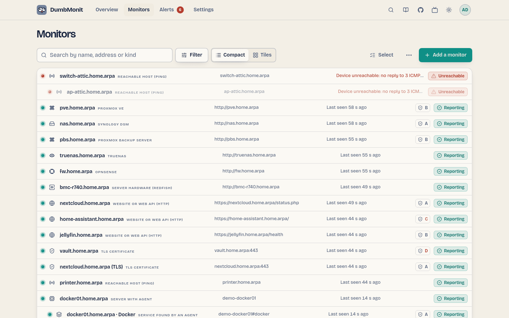
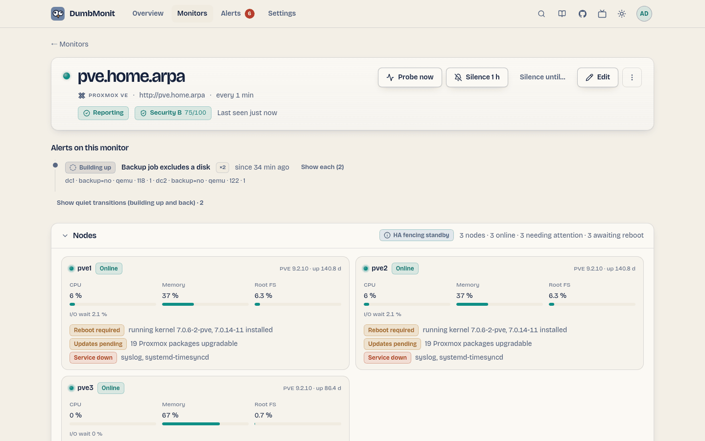

# La pagina dei monitor {#the-devices-page}

{ loading=lazy }

## Il rack {#the-rack}

Ogni monitor è una targhetta da rack 1U: un LED di stato, il nome, il
timbro del tipo, l'indirizzo, quando è stato visto per l'ultima volta e uno
sparkline di una metrica rappresentativa. I figli si impilano sotto il loro
genitore e si attenuano quando il genitore è irraggiungibile.

| Stato | Significato |
|---|---|
| Reporting | L'ultima sonda è riuscita, entro tre periodi. |
| Unreachable | Il monitor non ha risposto (timeout, connessione rifiutata), oppure nessuna sonda da più di tre periodi (almeno 90 s). |
| Misconfigured | L'ultima sonda è fallita dalla nostra parte: credenziali sbagliate, indirizzo o opzione non validi, risposta inattesa. Mostrato nel colore advisory con l'errore; non genera alcun avviso. |
| Waiting | Aggiunto, non ancora sondato. |
| Disabled | In pausa: non controllato, non genera alcun avviso. |

Filtri: una casella di ricerca, un segmento di stato (All, Needs attention,
Reporting, Disabled) e un filtro per tipo. **Add a device** è l'azione
primaria.

Il pulsante **Select** (operatori e amministratori) attiva una casella per
monitor e una barra flottante in basso con le azioni di gruppo; **Done**
o Escape escono dalla modalità.

## Un monitor {#a-device}

{ loading=lazy }

La pagina del monitor mostra la sua targhetta di stato, indirizzo, tipo,
profilo rilevato, tag, ultima sonda, e per i servizi lo stato del
certificato. Azioni:

| Azione | Effetto |
|---|---|
| Probe now | Esegue immediatamente una sonda e riporta quanti campioni e serie ha prodotto. La prima cosa da provare quando un monitor non mostra dati. |
| Edit | Apre lo stesso modulo usato per l'aggiunta, precompilato. Lasciare vuota la credenziale mantiene quella memorizzata. |
| Silence 1 h / Silence until… | Una finestra di manutenzione puntuale su questo monitor. |
| Delete | Chiede "Delete for good?" inline per cinque secondi, poi elimina il monitor. Le sue serie restano in VictoriaMetrics finché la retention non scade. |

Sotto: **Alerts on this device** — ogni avviso attivo offre *Ack*, *Snooze* e
*Ignore*, e una regola ignorata su questo monitor viene elencata
separatamente con **Stop ignoring** — poi **Metrics** su un intervallo
temporale (1 h, 6 h, 24 h, 7 giorni), un grafico per nome di metrica con una
linea per serie. Vedi
[Eliminare un avviso](alerts.md#getting-rid-of-an-alert).

I servizi (HTTP, TCP, DNS, ping, TLS) ricevono invece dei propri strumenti:
**Availability** nelle ultime 24 ore o 7 giorni, **Response time**, il numero
di **Checks**, e una barra **History** di slot (il più vecchio a sinistra)
che mostra quando il servizio era inattivo.

## Policy dei container {#container-policies}

Su una macchina con un agent e Docker, una striscia **Docker** si trova sotto
l'intestazione: numero di container, quanti sono in esecuzione, aggiornamenti
disponibili, e quanti container hanno una policy. **Manage containers** apre
l'elenco; **Policies…** apre una tabella con due interruttori per container e
una riga "Apply to all":

- **Restart if down** — il server riavvia il container entro un minuto dal
  suo arresto (al massimo una volta ogni dieci minuti);
- **Auto-update in maintenance windows** — quando il registry ha un'immagine
  più recente per lo stesso tag, il container viene ricreato durante una
  finestra di manutenzione pianificata (pagina Alerts → Maintenance) e
  ripristinato se il suo healthcheck fallisce.

Ogni interruttore salva per proprio conto. Dettagli e regole di sicurezza:
[Container Docker](../devices/agent.md#docker-containers).

## Aggiungere e modificare {#adding-and-editing}

Vedi [Aggiungi il tuo primo monitor](../install/first-device.md) per il
modulo e i [tipi di monitor](../devices/index.md) per ciò di cui ha
bisogno ciascun tipo. Durante la modifica, il modulo apre da solo **More
options** se il monitor ne usa già una.

## Eliminazione {#deleting}

Eliminare un monitor lo rimuove dalla configurazione, azzera i suoi
avvisi all'istante — nessuna notifica viene inviata, la cronologia conserva
una riga `device removed or disabled` — ed elimina le sue serie temporali
dal VictoriaMetrics integrato qualche secondo dopo (a titolo di tentativo: un
fallimento viene solo registrato nei log, e le serie poi scadono con la
retention di 12 mesi). Mettere in pausa un monitor azzera i suoi avvisi
nello stesso modo; le sue serie restano.
