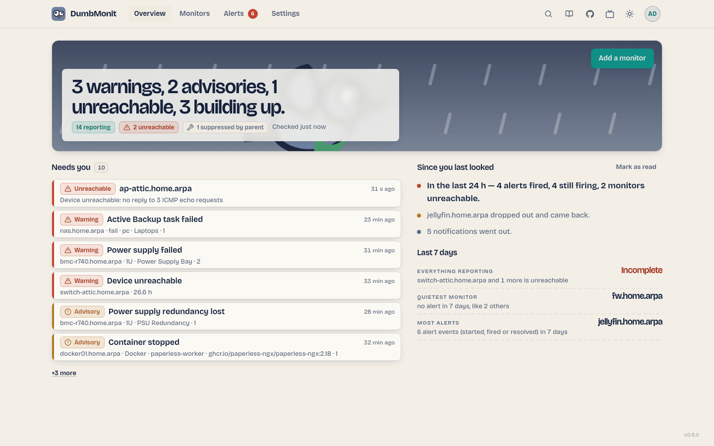
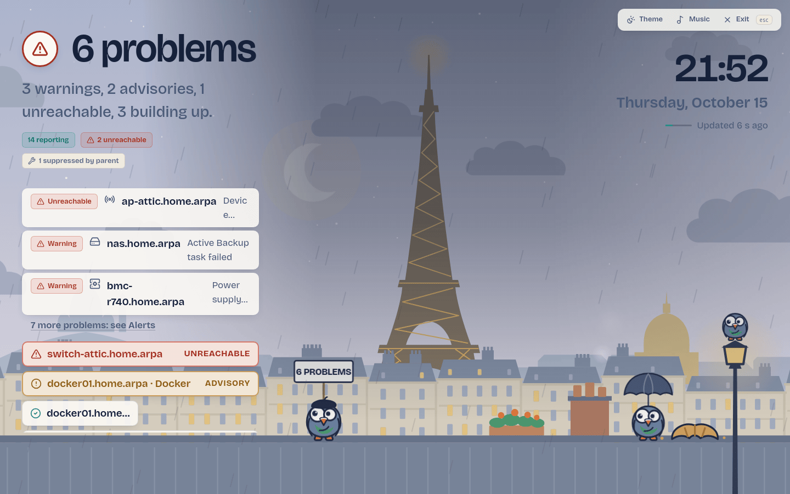

# Страница обзора

Главная страница отвечает на вопрос "все ли в порядке?" примерно за одну секунду, затем позволяет вам
детально разбираться по требованию.

{ loading=lazy }

## Бюллетень

Полоса вверху - это погодный бюллетень для вашей сети. Одно предложение описывает
небо: "Ясное небо." когда ничего вам не нужно, иначе подсчет того, что нужно
("9 рекомендаций, 1 недоступное."). Ниже пластины подсчитывают мониторы, сообщающие и
недоступные, с временем последней проверки, и три показателя: **Сообщаемые**,
**Требует вашего внимания**, **Прогнозы**.

Окно погоды справа следует за сетью: ясное, облачное, пасмурное или
штормовое, в зависимости от того, сколько оповещений срабатывают и насколько они серьезны, с
голубем, летящим по экрану. При `prefers-reduced-motion` все неподвижно.

Единственное основное действие страницы - это **Добавить монитор**.

## Руководство для первого запуска

На новом экземпляре страница под бюллетенем не пуста: это трехэтапный
путеводитель — добавить монитор, подключить способ уведомления, проверить поступление сообщения. Каждый
шаг - это один клик, каждый можно пропустить отдельно, и **Пропустить руководство** убирает
все три. Выбор сохраняется на экземпляре, поэтому второй браузер
не начинает руководство заново. См.
[Добавьте первый монитор](../install/first-device.md#the-three-first-steps).

## Требует вашего внимания

Список того, что требует вашего внимания сейчас, в порядке возрастания серьезности: недоступные мониторы, затем
срабатывающие оповещения по серьезности. Каждая строка называет правило, монитор, текущее
значение, как долго это происходит, и группирует ли оно несколько серий
("×4" для четырех файловых систем на одном мониторе). Четыре действия: **Подтвердить**
(подтвердить это оповещение на 1 ч, 4 ч, 24 ч или до разрешения — напоминания
паузируются, разрешение все еще уведомляется), **Отложить** (скрыть только это оповещение
на 1 ч, 8 ч, 1 день или до разрешения), **Игнорировать** (остановить это правило от когда-либо
оповещения на этом мониторе снова, обратимо), и **Открыть монитор**.

Подтвержденные и отложенные оповещения перемещаются в свою собственную более тихую группу под
списком и уходят из подсчета *Требует вашего внимания*. Игнорируемое оповещение исчезает совсем —
оно не "известно", оно отключено для этого монитора. См.
[Избавиться от оповещения](alerts.md#getting-rid-of-an-alert).

## Итоговая информация о мониторах

Одна строка: сколько мониторов, сколько сообщает, сколько недоступно, и
ссылка на полную страницу мониторов. Обзор никогда не перечисляет мониторы: стойка находится
на [Мониторы](devices.md).

## Прогнозы и последние 24 часа

**Прогнозы** показывают то, что предсказано, а не наблюдалось: аномалия сезонной
базовой линии, экстраполяции "заполнится в течение четырех дней", оценка
заполнения PBS, и правила, чье название объявляет прогноз. Пока базовая линия
учится, ее записи это указывают.

**Последние 24 часа** перечисляют переходы срабатывания дня, со ссылкой на
полную историю на странице оповещений.

## Режим стены {#wall-mode}

`/wall` показывает только бюллетень, на полный экран, для монитора комнаты: предложение,
подсчеты и список *Требует вашего внимания*, обновляемый каждые 20 секунд, с
экраном в бодрствующем состоянии. ++esc++ или **Выход** возвращается к обзору. Откройте его из
палитры команд ("Режим стены") или введя URL. Он также может воспроизводить музыку,
запущенную с телефона: см. [Режим стены и музыка](wall.md).

{ loading=lazy }

## Установить на телефон

Интерфейс поставляется с веб-манифестом, поэтому телефон может добавить его на главный экран:
**Поделиться → Добавить на главный экран** на iOS, **Установить приложение** в меню Chrome на
Android. Затем он открывается без браузера chrome, в теме, на которую установлен телефон.

Намеренно **нет режима без сети и без рабочего процесса обслуживания**. Экран мониторинга,
на котором отображается кэшированная страница, хуже, чем тот, который говорит, что он не может достичь
сервер: суть в том, что то, что вы читаете, актуально. Без рабочего процесса,
обновленный сервер также подается сразу же, без устаревшей сборки для очистки.

## Палитра команд

++cmd+k++ на macOS, ++ctrl+k++ в другом месте, открывает палитру команд: один
ввод, результаты в трех группах.

| Группа | Записи |
|---|---|
| Страницы | Обзор, Мониторы, Оповещения, Уведомления, Страницы статуса, Параметры, Режим стены, Документация |
| Действия | Добавить монитор, Сканировать мою сеть, Запланировать техническое обслуживание, Добавить канал уведомлений, Новая страница статуса, Объявить инцидент, Переключить тему |
| Мониторы | Каждый монитор со своим светодиодом состояния; ++enter++ открывает его |

## Навигация

Верхняя панель имеет Обзор, Мониторы, Оповещения (с подсчетом того, что требует вашего внимания)
и Параметры, ярлык палитры и переключение темы. На телефоне это
становится нижней панелью вкладок с этими четырьмя вкладками и пунктом **Ещё**, в котором
находятся режим стены и документация.

- **Обзор** — бюллетень: все ли в порядке, и что требует вашего внимания.
- **Мониторы** — стойка; каждый источник, который вы мониторите. См. [Страница мониторов](devices.md).
- **Оповещения** — то, что срабатывает, окна обслуживания, история и правила.
  См. [Страница оповещений](alerts.md).
- **Параметры** — ваша учетная запись, пользователи и единый вход, маркеры агента и помощника,
  каналы уведомлений и отчёты, общедоступные страницы статуса, внешний вид,
  о программе. См. [Параметры](settings.md). Ничего в интерфейсе не передает статус только по цвету: пластина
или светодиод всегда сопровождаются словом (Сообщаемые, Недоступные, Рекомендация,
Предупреждение, Подавлено родителем, Наращивание).
